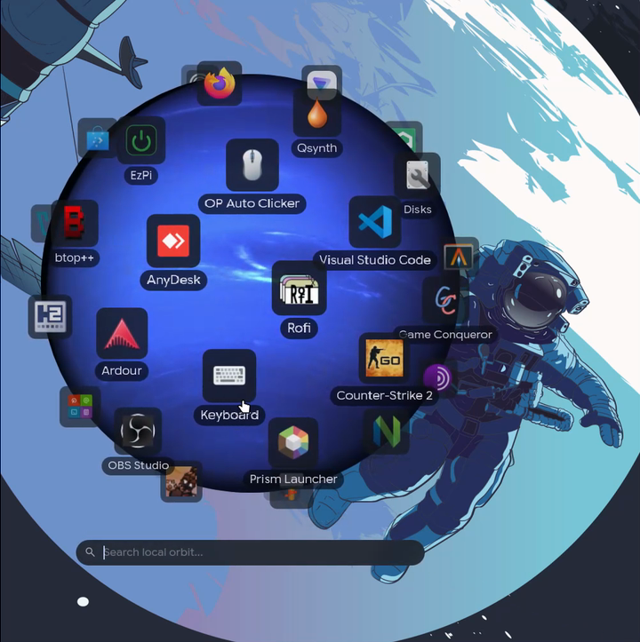
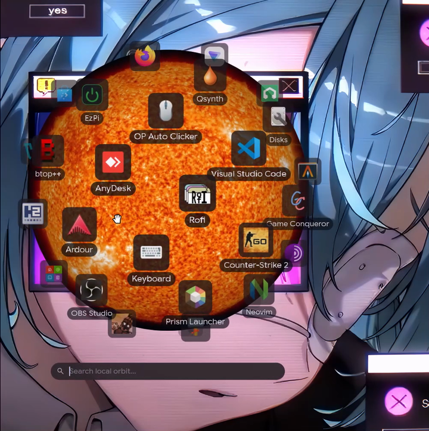
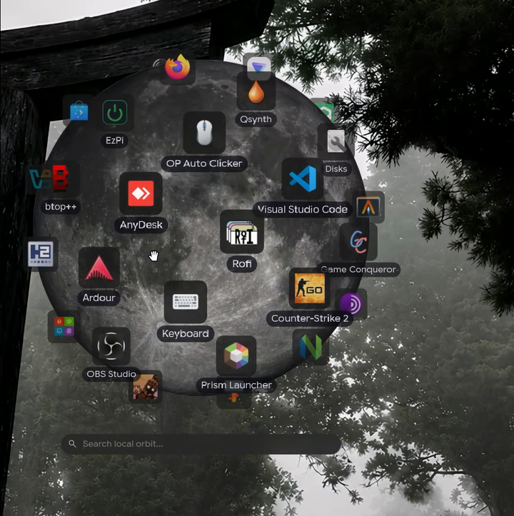

# Orbit

A planet app launcher for Linux. Your apps orbit a spinning planet; type to
search and the orbit turns the match towards you.

It's a standalone program like wofi or rofi: one small binary with its own
config file, built on plain Qt 6. It needs no shell, bar or quickshell and runs
on Hyprland, KDE Plasma, Sway, river, niri and other Wayland compositors, and on
X11. It can also be loaded as a module inside any quickshell config.

Discord: https://discord.gg/eBAz5q7TpY

<p align="center"></p>

<p align="center">
  
  
  
</p>

## Install

Dependencies (Arch / Artix / Manjaro):

```
sudo pacman -S --needed base-devel cmake git qt6-base qt6-declarative qt6-svg qt6-wayland layer-shell-qt
```

Debian / Ubuntu (24.04+): `cmake g++ qt6-base-dev qt6-declarative-dev
qt6-wayland liblayershellqtinterface-dev qml6-module-qtquick qml6-module-qtquick-window
qml6-module-qtquick-effects`. Fedora: `cmake gcc-c++ qt6-qtbase-devel
qt6-qtdeclarative-devel qt6-qtwayland layer-shell-qt-devel`.

`layer-shell-qt` is optional. With it Orbit is a proper overlay on Wayland
(like wofi); without it, or on X11, it opens as a borderless window that stays
on top.

```
git clone https://github.com/SunqdXX/OrbitLauncher
cd OrbitLauncher
./install.sh                  # builds and installs to ~/.local
sudo ./install.sh --system    # builds and installs to /usr
```

On Arch-based systems you can also build a package with the included
PKGBUILD: `cd pkg && makepkg -si`.

`./install.sh --uninstall` removes it again (add `--system` if you installed
it that way). Your `~/.config/orbit` is not touched.

Manual build: `cmake -B build && cmake --build build`, the binary is
`build/orbit` and has the QML, planets and default config built in.

## Usage

```
orbit
```

opens the launcher; running it again closes it. In Hyprland:

```
bind = SUPER, A, exec, orbit
```

Sway / i3: `bindsym $mod+a exec orbit`. KDE Plasma: System Settings >
Keyboard > Shortcuts > Add New > Command, and enter `orbit`.

Keys: type to search, Enter launches, Up/Down, Tab or Ctrl+J/K move between
results, Esc closes. You can drag the orbit to spin it.

Other commands:

```
orbit daemon            stay in memory so it opens instantly
orbit open | close      explicit open/close
orbit reload            re-read the config
orbit kill              stop the daemon
orbit init [-f]         write a fresh config and copy the planets
orbit planets           list available planets
orbit import-caelestia  import app launch counts from caelestia
orbit doctor            check the setup (send this output when asking for help)
orbit -c FILE ...       use a different config file
```

By default Orbit only runs while it's open and exits when you close it. With
`orbit daemon` (e.g. `exec-once = orbit daemon`) it opens faster but stays in
memory; the window and everything in it is unloaded while hidden.

## Troubleshooting

Run `orbit doctor` and then `orbit` from a terminal; any problem is printed
there. Common ones:

- `cannot open shared object` / `module "QtQuick" is not installed`: install
  `qt6-declarative` (and `qt6-svg`, `qt6-wayland`).
- `layer-shell: not built in`: install `layer-shell-qt` and rebuild
  (`./install.sh` again). It still works without it, as a normal window.
- Opens on X11 under a Wayland session: install `qt6-wayland`.
- No icons: set `icon_theme = Papirus-Dark` (or any installed theme) in
  orbit.conf. `orbit doctor` shows which theme was picked and why.
- Black or broken drawing in a VM or on an old GPU: `renderer = software`.

## Configuration

The first run creates `~/.config/orbit/orbit.conf` and copies the planets to
`~/.config/orbit/planets/`. Changes to the file apply as soon as you save it.
Every option is listed with its default in
[config/orbit.conf](config/orbit.conf). Some of them:

```
planet = saturn          # file name in planets_dir, or auto / random
size = 600               # orbit diameter in px, auto fits the screen
search_opacity = 0.6     # 0 transparent, 1 solid
theme_file = ~/.local/state/caelestia/scheme.json
favourite_apps = firefox, kitty
hidden_apps = /^steam_app/
max_fps = 60
renderer = software
```

Planets: earth, jupiter, mars, moon, neptune, saturn, serpulo, sun and uranus
are included. To add one, put an image (png, jpg, webp or svg) in the planets
folder and set `planet` to its name. Square images where the planet fills the
frame work best.

Colours default to a dark palette. `theme_file` reads the JSON written by
caelestia, matugen or pywal and follows it when it changes. Individual colours
can also be set directly.

On Hyprland the search bar gets background blur through a runtime layer rule
(`blur = false` turns it off). Nothing is written to your Hyprland config. The
layer namespace is `orbit` if you want your own rules.

## Using it inside a quickshell config

This mode needs [quickshell](https://quickshell.org); the standalone `orbit`
binary does not. Copy the `Orbit` directory next to your `shell.qml` (or run
`sudo ./install.sh --system`, which makes `import Orbit` available everywhere)
and add:

```qml
import qs.Orbit

ShellRoot {
    // ...

    OrbitWindow {
        config: OrbitConfig {
            source: Quickshell.env("HOME") + "/.config/orbit/orbit.conf"
        }
    }
}
```

Toggle it with `bind = SUPER, A, global, quickshell:orbit`, or
`qs -c <config> ipc call orbit toggle`.

Config options are also properties, so you can bind them to your shell's
colours instead of using a file:

```qml
OrbitConfig {
    primary: Colours.palette.m3primary
    surfaceContainer: Colours.palette.m3surfaceContainer
    textColour: Colours.palette.m3onSurface
}
```

`OrbitView` is the launcher without a window, for putting inside a panel you
already have. Give its config a backend (`backend: QuickshellBackend {}`); it
emits `requestClose()` when it wants to be hidden. Both setups
are in [examples/](examples) and can be run with `qs -p examples/plugin-window`.

## Memory

Closed: nothing, the process exits. Open: roughly 55 MB with
`renderer = software` and more with the GPU renderer depending on the driver
(NVIDIA's GL stack alone is about 80 MB). As a daemon the launcher is unloaded
while hidden.

## Tests

```
tests/run.sh            # build, unit, cli, socket/lifecycle, offscreen renders, install
tests/run.sh --live     # also opens real windows (layer-shell, X11, quickshell plugin)
```

They run in a temporary directory and don't touch your config. Nothing appears
on screen without `--live`.

## Credits

See [CREDITS.md](CREDITS.md). Licensed under the GPL-3.0.
